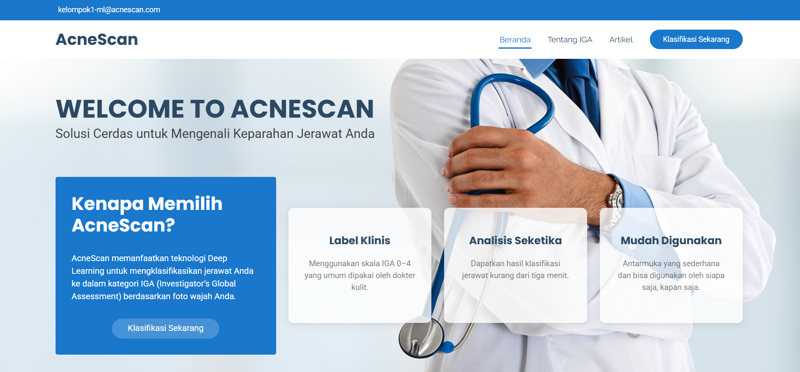
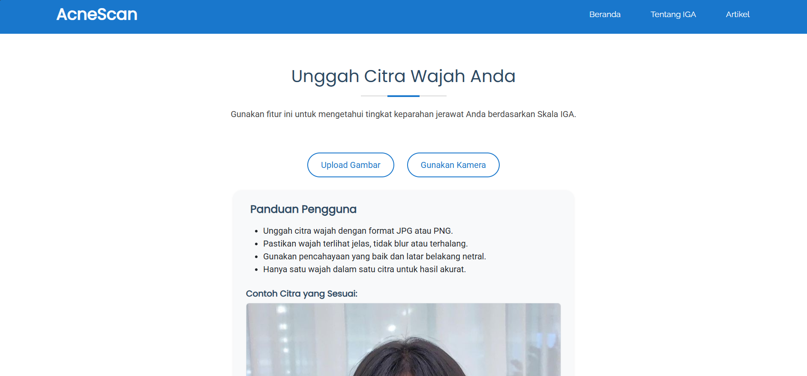
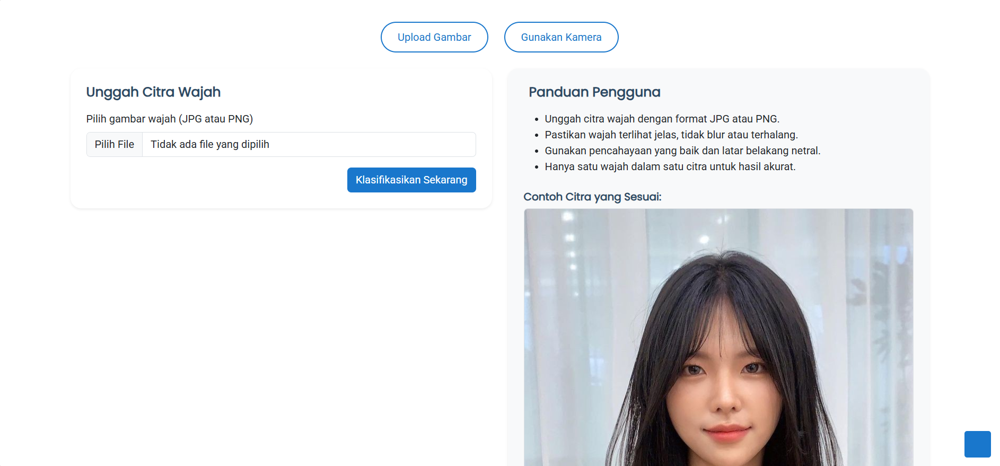
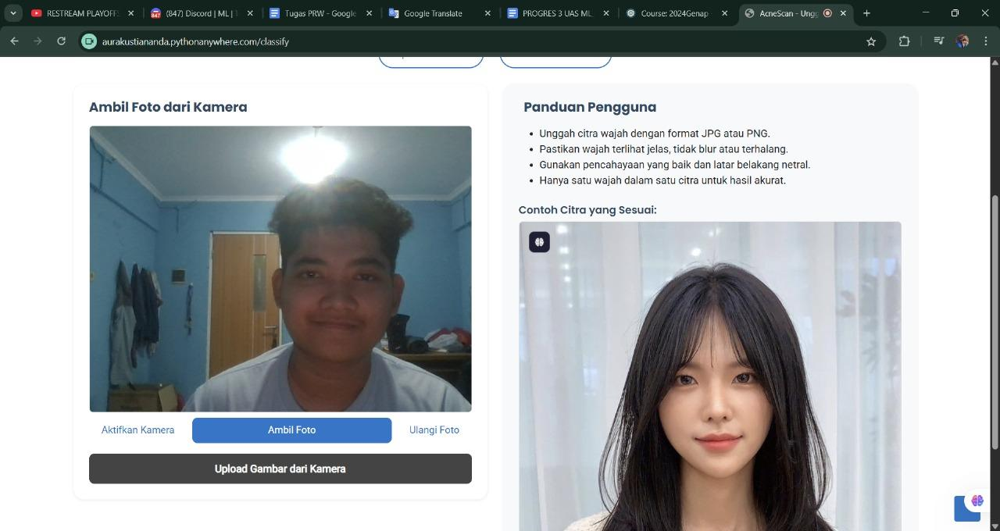
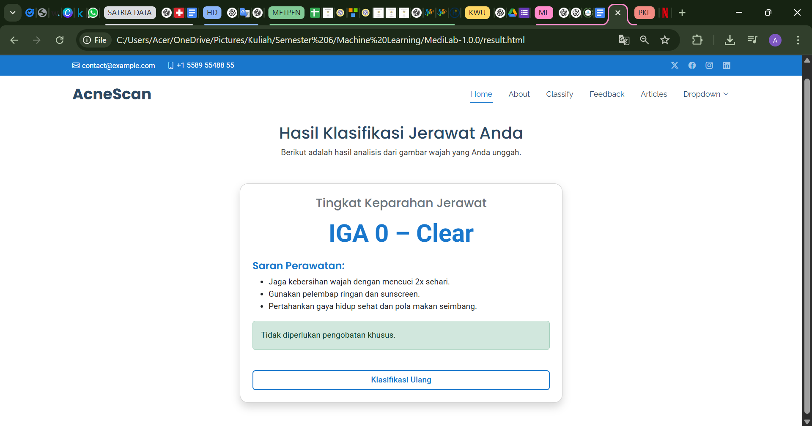
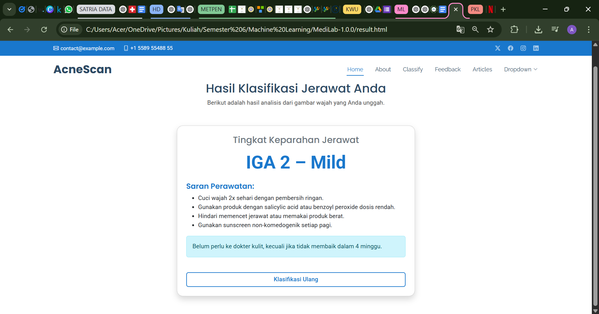
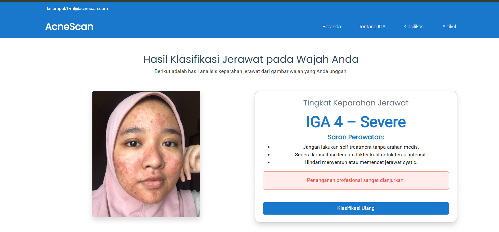
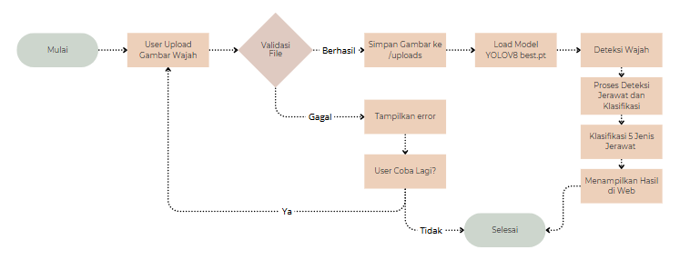
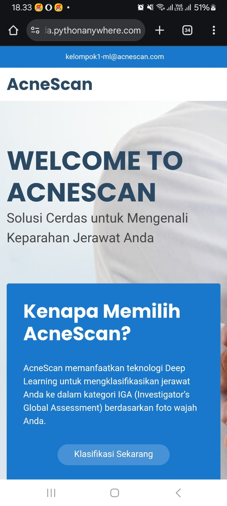

# AcneScan — Web-Based Acne Severity Classification

## Gambaran Proyek

**AcneScan** merupakan aplikasi web berbasis **Python dan Flask** yang dikembangkan untuk mengklasifikasikan tingkat keparahan jerawat melalui analisis citra wajah menggunakan model **YOLOv8**. Sistem menerapkan skala *Investigator's Global Assessment* (IGA), yang mengelompokkan tingkat keparahan jerawat menjadi lima kategori, mulai dari IGA 0 (*Clear*) hingga IGA 4 (*Severe*).

Aplikasi memungkinkan pengguna mengunggah foto wajah dari perangkat atau mengambil gambar melalui kamera, kemudian memperoleh hasil prediksi tingkat keparahan jerawat beserta penjelasan kategori dan informasi perawatan yang relevan. Proses penerimaan gambar, validasi input, integrasi model, dan penyajian hasil ditangani oleh backend Flask, sedangkan frontend dikembangkan dengan menyesuaikan template berbasis **HTML, CSS, JavaScript, dan Bootstrap** agar dapat digunakan pada perangkat desktop maupun mobile.

Proyek ini dikembangkan oleh **Kelompok 1 SD-A1** sebagai *team-based project* untuk **Ujian Akhir Semester (UAS) mata kuliah Machine Learning, Program Studi S1 Teknologi Sains Data, Universitas Airlangga, tahun 2025**. Pengembangan mencakup persiapan dataset, eksperimen dan evaluasi model klasifikasi, pengembangan frontend dan backend, integrasi model dengan aplikasi web, pengujian fungsionalitas, serta deployment ke PythonAnywhere.

**Teknologi utama:** Python, Flask, YOLOv8, Ultralytics, HTML, CSS, JavaScript, Bootstrap, Docker, dan PythonAnywhere.

### Tampilan Aplikasi

Halaman utama AcneScan menyediakan pengenalan aplikasi, informasi mengenai skala IGA, panduan penggunaan, serta navigasi menuju halaman klasifikasi. Antarmuka dirancang agar pengguna dapat memahami tujuan aplikasi dan tahapan analisis gambar sebelum melakukan klasifikasi.



---

## Fitur Utama

### Antarmuka Web dan Navigasi

AcneScan menyediakan antarmuka berbasis web yang mengintegrasikan halaman informasi dan fitur klasifikasi dalam satu aplikasi. Halaman utama memperkenalkan fungsi sistem serta menyediakan penjelasan mengenai skala IGA dan bagian *Frequently Asked Questions* (FAQ), sementara halaman klasifikasi memberikan akses ke metode pengambilan gambar yang tersedia.

Frontend dikembangkan menggunakan template berbasis Bootstrap yang disesuaikan dengan kebutuhan aplikasi melalui HTML, CSS, dan JavaScript. Penyesuaian mencakup tata letak halaman, navigasi, komponen formulir, pratinjau gambar, dan penyajian hasil prediksi. Desain antarmuka mempertimbangkan kemudahan penggunaan agar proses klasifikasi dapat diikuti tanpa memerlukan pemahaman teknis mengenai Machine Learning.



### Unggah Gambar dan Pengambilan Foto

Pengguna dapat memasukkan citra wajah melalui dua metode, yaitu **unggah gambar** dari perangkat dan **pengambilan foto melalui kamera**. Metode unggah mendukung file JPG dan PNG, sedangkan fitur kamera memungkinkan pengguna mengambil gambar secara langsung melalui perangkat yang memiliki akses kamera.

Pada metode unggah gambar, antarmuka menyediakan formulir input dan pratinjau gambar sebelum proses klasifikasi dilakukan. Ketika pengguna mengirimkan gambar, input diteruskan ke backend Flask untuk diperiksa dan diproses. Validasi dilakukan terhadap keberadaan file dan kesesuaian format gambar agar sistem tidak menjalankan inferensi pada input yang tidak memenuhi ketentuan. Jika pengguna mencoba mengirimkan formulir tanpa memilih gambar, aplikasi menampilkan peringatan agar input dilengkapi terlebih dahulu.

**Tampilan Unggah Gambar**



**Tampilan Pengambilan Foto melalui Kamera**



### Klasifikasi Tingkat Keparahan Jerawat

Gambar yang berhasil diterima dan divalidasi diproses menggunakan model YOLOv8 yang telah dilatih untuk mengenali karakteristik visual tingkat keparahan jerawat. Model menghasilkan prediksi berdasarkan skala IGA dengan enam label, yaitu IGA 0 (*Clear*), IGA 1 (*Almost Clear*), IGA 2 (*Mild*), IGA 3 (*Moderate*), IGA 4 (*Severe*), dan *Non-Wajah*.

Kelima kategori IGA merepresentasikan tingkat keparahan jerawat, mulai dari kondisi kulit yang bersih hingga kondisi jerawat berat. Kategori Non-Wajah ditambahkan untuk membantu sistem membedakan gambar wajah dari input yang tidak sesuai untuk proses klasifikasi jerawat.

Setelah proses inferensi selesai, backend memproses label hasil prediksi dan meneruskannya ke frontend. Informasi tersebut kemudian ditampilkan melalui halaman hasil agar pengguna dapat membaca kategori yang diprediksi beserta penjelasannya.

### Penyajian Hasil dan Informasi Perawatan

Halaman hasil AcneScan menampilkan kategori tingkat keparahan jerawat berdasarkan prediksi model, disertai penjelasan mengenai karakteristik kategori IGA tersebut dan informasi perawatan yang relevan. Penyajian hasil dirancang agar pengguna dapat memahami perbedaan tingkat keparahan jerawat melalui informasi yang mudah dibaca.

Untuk kategori IGA yang lebih ringan, penjelasan berfokus pada kondisi kulit dengan lesi minimal, sedangkan kategori yang lebih berat memberikan informasi mengenai kondisi jerawat yang memerlukan perhatian lebih lanjut. Apabila input diprediksi sebagai Non-Wajah, aplikasi menampilkan pemberitahuan bahwa gambar tidak sesuai untuk klasifikasi.

Berikut beberapa contoh hasil klasifikasi yang ditampilkan oleh aplikasi.

**IGA 0 — Clear**



**IGA 2 — Mild**



**Tampilan Halaman Hasil**



---

## Arsitektur dan Implementasi Sistem

AcneScan mengintegrasikan frontend berbasis Bootstrap, backend Flask, dan model klasifikasi YOLOv8 dalam satu alur pemrosesan. Frontend berperan sebagai antarmuka interaksi pengguna, backend menangani pengelolaan input dan pemanggilan model, sedangkan komponen Machine Learning digunakan untuk menghasilkan prediksi tingkat keparahan jerawat.

### Alur Kerja Aplikasi

Proses dimulai ketika pengguna membuka halaman klasifikasi dan memilih metode input gambar. Foto wajah yang diunggah atau diambil melalui kamera dikirimkan ke backend Flask untuk melalui tahap validasi. Setelah input dinyatakan sesuai, gambar disiapkan untuk proses inferensi menggunakan model YOLOv8 yang tersimpan dalam file bobot `best.pt`.

Model melakukan pemrosesan citra dan menghasilkan probabilitas untuk masing-masing kategori. Kelas dengan probabilitas tertinggi dipilih sebagai hasil prediksi, kemudian diteruskan oleh backend kepada frontend. Halaman hasil menampilkan gambar yang diproses, kategori IGA atau Non-Wajah, serta informasi pendukung yang berkaitan dengan hasil klasifikasi tersebut.

Alur komunikasi ini memungkinkan pemrosesan Machine Learning dijalankan sebagai bagian dari aplikasi web, tanpa mengharuskan pengguna berinteraksi langsung dengan kode atau model.



### Implementasi Frontend

Antarmuka dikembangkan menggunakan HTML, CSS, JavaScript, dan Bootstrap. Template frontend disesuaikan untuk menyediakan navigasi yang terstruktur, formulir unggah gambar, fitur pengambilan foto, serta halaman hasil klasifikasi. Aplikasi juga menampilkan informasi edukatif mengenai skala IGA dan panduan penggunaan agar pengguna memahami fungsi sistem sebelum melakukan analisis.

Pengembangan frontend mempertimbangkan keterhubungan setiap komponen dengan proses backend. Ketika gambar dipilih atau diambil, antarmuka menyediakan mekanisme pengiriman input untuk diproses, kemudian menampilkan hasil yang diterima dari Flask. Penyesuaian tata letak dan komponen responsif dilakukan agar pengalaman penggunaan tetap konsisten pada browser desktop maupun mobile.

### Implementasi Backend

Backend dibangun menggunakan **Python dan Flask** untuk menangani routing, penerimaan dan validasi gambar, integrasi model klasifikasi, serta penyajian hasil melalui template HTML. Proses pemrosesan gambar dikelola oleh aplikasi Flask yang memuat file bobot YOLOv8 dan menjalankan inferensi berdasarkan input pengguna.

Integrasi backend dan model memungkinkan klasifikasi dilakukan langsung melalui aplikasi web. Setelah model menghasilkan prediksi, backend mengelola informasi hasil dan meneruskannya ke halaman yang sesuai. Dengan pendekatan tersebut, logika pemrosesan citra dan komponen antarmuka dapat dikembangkan serta diuji secara terpisah sebelum diintegrasikan.

---

## Responsive Web Design

Antarmuka AcneScan dirancang untuk menyesuaikan ukuran layar perangkat desktop dan mobile dengan memanfaatkan sistem tata letak serta komponen responsif Bootstrap. Penyesuaian diterapkan pada navigasi, susunan konten, formulir klasifikasi, pilihan metode input gambar, dan halaman hasil agar elemen-elemen utama tetap mudah diakses pada perangkat dengan ukuran layar berbeda.

Dalam pengembangan aplikasi, tampilan desktop dan mobile diperiksa pada beberapa halaman, termasuk beranda, klasifikasi, fitur unggah gambar, kamera, serta halaman hasil prediksi. Perbandingan ini digunakan untuk memastikan bahwa perubahan ukuran layar tidak mengganggu keterbacaan informasi dan alur penggunaan aplikasi.

**Tampilan Mobile AcneScan**



---

## Pengembangan dan Evaluasi Model YOLOv8

### Persiapan Data dan Proses Pemodelan

Pengembangan model menggunakan dataset citra wajah dari **Roboflow** yang terdiri atas **2.457 gambar** dengan lima label tingkat keparahan jerawat berdasarkan skala IGA. Distribusi data mencakup 327 gambar IGA 0, 476 gambar IGA 1, 671 gambar IGA 2, 638 gambar IGA 3, dan 345 gambar IGA 4. Selain citra wajah tersebut, digunakan **114 gambar non-wajah** yang dikumpulkan melalui pengambilan gambar menggunakan kamera untuk membantu model mengenali input di luar kategori wajah manusia.

Dataset yang tersedia disiapkan melalui proses penggabungan dan pembagian ulang ke dalam data pelatihan, validasi, serta pengujian dengan rasio **70:20:10**. Struktur data disusun berdasarkan kelas agar pemetaan label dapat dilakukan secara konsisten selama proses pelatihan dan evaluasi. Penyiapan data ini bertujuan untuk membangun model yang mampu membedakan tingkat keparahan jerawat sekaligus mengenali gambar yang tidak sesuai dengan konteks klasifikasi.

Eksperimen dilakukan menggunakan beberapa varian **YOLOv8 untuk image classification**, yaitu Nano, Small, Medium, Large, dan Extra Large. Setiap varian diuji dengan variasi resolusi input, termasuk 224 × 224, 384 × 384, dan 512 × 512 piksel, untuk membandingkan pengaruh ukuran citra dan kompleksitas arsitektur terhadap performa model. Proses pelatihan dan *hyperparameter tuning* menggunakan metode `.tune()` selama 100 epoch, dengan caching untuk mempercepat pemuatan data dan validasi untuk memantau performa model selama pelatihan.

Setelah proses pelatihan, model-model yang dihasilkan dievaluasi dengan mempertimbangkan akurasi, confidence prediksi, waktu inferensi, dan efisiensi komputasi. Evaluasi ini tidak hanya ditujukan untuk memilih model dengan performa klasifikasi yang baik, tetapi juga untuk memperoleh konfigurasi yang sesuai dengan kebutuhan aplikasi berbasis web, di mana ukuran model dan waktu pemrosesan turut memengaruhi pengalaman pengguna.

### Pemilihan Model dan Hasil Evaluasi

Dari enam konfigurasi yang dibandingkan dalam pengujian *trade-off*, **YOLOv8 Nano dengan resolusi 512 × 512 piksel** dipilih sebagai konfigurasi terbaik. Model tersebut menghasilkan skor gabungan tertinggi sebesar **0,8055**, dengan akurasi sebesar **83,33%**, rata-rata confidence **0,9405**, dan waktu inferensi persentil ke-95 sekitar **303,73 milidetik**. Meskipun beberapa konfigurasi lain memiliki confidence lebih tinggi atau waktu inferensi lebih singkat, Nano 512 dinilai memberikan keseimbangan terbaik berdasarkan kriteria evaluasi dan pembobotan yang digunakan dalam penelitian.

Evaluasi lebih lanjut terhadap model terpilih dilakukan menggunakan **657 sampel pengujian**. Hasil *classification report* menunjukkan bahwa model memperoleh **akurasi sebesar 82%**, dengan *macro precision* **0,85**, *macro recall* **0,81**, dan *macro F1-score* **0,83**. Nilai *weighted F1-score* sebesar **0,82** memberikan gambaran performa keseluruhan dengan mempertimbangkan jumlah sampel pada masing-masing kelas. Penggunaan macro F1-score menjadi penting karena distribusi data antar kelas tidak seimbang, sehingga penilaian kinerja model tidak cukup hanya berdasarkan akurasi keseluruhan.

Performa model berbeda pada setiap kategori. IGA 0 menghasilkan F1-score **0,86**, sementara kategori Non-Wajah mencapai F1-score **0,97** pada 15 sampel pengujian. Sebaliknya, IGA 3 memperoleh F1-score terendah sebesar **0,69** dengan recall **0,65**. Analisis *confusion matrix* menunjukkan adanya kesalahan klasifikasi terutama pada kategori yang memiliki karakteristik visual berdekatan, seperti IGA 1, IGA 2, dan IGA 3. Hasil ini menunjukkan bahwa model telah mampu mengenali pola tingkat keparahan jerawat, tetapi masih menghadapi tantangan dalam membedakan kategori dengan karakteristik visual yang saling tumpang tindih.

---

## Functional Testing dan Debugging

Pengujian fungsionalitas aplikasi dilakukan menggunakan pendekatan **black-box testing** untuk memeriksa apakah fitur-fitur web berfungsi sesuai rancangan tanpa bergantung pada detail implementasi internal. Pengujian mencakup akses halaman utama, navigasi ke halaman klasifikasi, penggunaan fitur unggah gambar dan kamera, validasi formulir tanpa gambar, pengiriman gambar ke backend, penanganan hasil Non-Wajah, serta penampilan hasil prediksi. Berdasarkan pengujian yang didokumentasikan dalam laporan proyek, **seluruh tujuh skenario pengujian memperoleh status berhasil**, yang menunjukkan bahwa alur utama aplikasi berjalan sesuai dengan perilaku yang diharapkan pada lingkungan pengujian.

Selama proses integrasi dan evaluasi, dilakukan pula pemeriksaan terhadap masalah pada hasil prediksi model YOLOv8. Salah satu keterbatasan yang ditemukan adalah kesalahan klasifikasi terhadap objek non-wajah yang memiliki bentuk membulat atau tekstur menyerupai kulit manusia. Walaupun kategori Non-Wajah memperoleh hasil yang baik pada dataset pengujian, pemeriksaan terhadap gambar di luar dataset memperlihatkan bahwa model belum sepenuhnya mampu membedakan seluruh objek non-wajah dari citra wajah manusia. Temuan ini menjadi bagian dari evaluasi sistem dan menunjukkan perlunya peningkatan keragaman data untuk memperbaiki kemampuan generalisasi model.

---

## Deployment ke PythonAnywhere

AcneScan **berhasil di-deploy ke PythonAnywhere pada 11 Juni 2025** sebagai bagian dari implementasi dan pengujian aplikasi Flask pada lingkungan web hosting. Proses deployment dilakukan dengan menyiapkan virtual environment menggunakan Python 3.13, memasang dependensi yang diperlukan seperti Flask dan Ultralytics, serta mengunggah kode backend, template HTML, aset frontend, dan file bobot model YOLOv8 ke server PythonAnywhere.

Konfigurasi aplikasi disesuaikan dengan lingkungan hosting agar Flask dapat memuat model dan melayani request pengguna melalui browser. Selama pengembangan, Docker digunakan sebagai alat bantu pengujian lingkungan lokal, tetapi deployment akhir dilakukan **tanpa container Docker** karena mempertimbangkan ukuran image dan keterbatasan platform hosting.

Aplikasi sebelumnya tersedia melalui `https://aurakustiananda.pythonanywhere.com/` dan berhasil diakses serta diuji setelah deployment. **Layanan hosting tersebut saat ini sudah tidak aktif (offline)**, sementara kode sumber dan dokumentasi pengembangan tetap tersedia melalui repository GitHub.

---

## Menjalankan Aplikasi Secara Lokal

Aplikasi dapat disiapkan pada lingkungan lokal menggunakan Python dan dependensi yang tersedia dalam repository.

### Clone Repository

```bash
git clone https://github.com/aura-najma/acnescan.git
cd acnescan
```

### Membuat Virtual Environment

```bash
python -m venv .venv
```

Aktifkan virtual environment pada Windows CMD:

```bat
.venv\Scripts\activate
```

Kemudian instal dependensi Python:

```bash
pip install -r requirements.txt
```

### Menjalankan Flask

```bash
flask --app app/app.py run
```

Aplikasi menggunakan model YOLOv8 yang tersimpan pada `app/model/best.pt`. Pengoperasian pada lingkungan baru memerlukan dependensi yang kompatibel dan konfigurasi path model yang sesuai dengan aplikasi.

---

## Teknologi yang Digunakan

| Teknologi | Penggunaan |
|---|---|
| **Python** | Pengembangan backend dan integrasi model |
| **Flask** | Routing, validasi gambar, inferensi model, dan penyajian hasil |
| **HTML, CSS, JavaScript** | Pengembangan dan penyesuaian antarmuka web |
| **Bootstrap** | Template frontend dan desain responsif |
| **YOLOv8 / Ultralytics** | Klasifikasi tingkat keparahan jerawat |
| **PyTorch** | Format bobot dan eksekusi model |
| **Docker** | Pengujian lingkungan aplikasi secara lokal |
| **PythonAnywhere** | Deployment aplikasi web |
| **Git & GitHub** | Version control dan kolaborasi pengembangan |

---

## Tim Pengembang

AcneScan dikembangkan oleh **Kelompok 1 SD-A1**, yang terdiri dari:

- Brilliant Pridgar Ednesto
- Aura Najma Kustiananda
- Putu Angga Kurniawan
- Ditha Meiga Zakaria
- Elzandi Irfan Zikra

AcneScan dikembangkan sebagai prototipe aplikasi web berbasis Machine Learning untuk mendukung edukasi mengenai tingkat keparahan jerawat. Hasil klasifikasi dan informasi perawatan yang disediakan tidak dimaksudkan untuk menggantikan pemeriksaan atau diagnosis oleh tenaga medis profesional.
